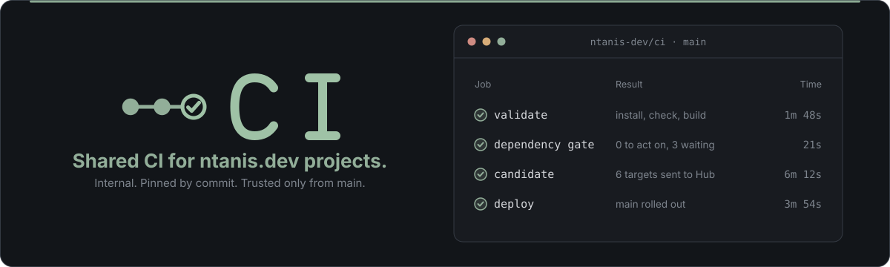

<p align="center">
  
</p>

**The shared GitHub Actions workflows behind ntanis.dev's own projects.** They check, scan, build and deploy those
projects and register each one with [ntanis.dev](https://ntanis.dev).

This repository is internal. It is public only so the projects' workflows can call it. It is not meant for anyone
else's repositories: there is no support, no stability promise, and anything here can change or disappear without
notice.

## What's here

| Workflow | What it does |
| --- | --- |
| `project-validate.yml` | Installs, checks and builds a pnpm project, and checks its dependency advisories. |
| `project-candidate.yml` | Builds release files for each platform and uploads them to the Hub. |
| `project-container-service.yml` | Builds a container image, publishes it and asks the Hub to deploy it. |
| `project-kubernetes-service.yml` | The older, pnpm-only build and deploy. |
| `register-project.yml` | Registers a repository's project contract with the Hub. |
| `report-hosted-deployment.yml` | Reports a hosted deployment to the Hub. |
| `ghcr-retention.yml` | Deletes old container image versions and keeps the newest. |
| `dependency-scan.yml` | Scans dependencies every week and fails only when someone has to act. |
| `dependency-maintenance.yml` | Applies dependency fixes every Monday, once they are two weeks old. |

Each project pins these workflows to a full commit on `main`.

## Development

```sh
node --test tests/*.test.mjs
```

## License and security

MIT, see [LICENSE](LICENSE). To report a vulnerability, please use GitHub's private vulnerability reporting, as
described in [SECURITY.md](SECURITY.md).
